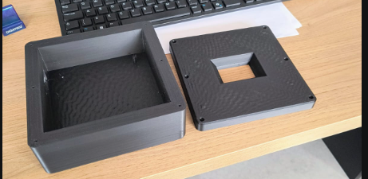

# Etapa 3

Nesta etapa, o gerador de funções evoluiu dos ensaios isolados da Etapa 2 para um protótipo com firmware integrado, interface touchscreen e blocos analógicos validados em bancada. O trabalho abrangeu geração pelo DAC, circuitos de conformação, offset, amplificação, esquemático e gabinete. Os subsistemas digitais e analógicos foram avaliados, mas a cadeia completa ainda não foi validada como um único equipamento.

## Desenvolvimento

### Firmware e interface

A interface anteriormente prototipada no Arduino foi portada para o STM32F439ZI [1]. O display TFT resistivo de 2,4 polegadas utiliza o controlador RM68090 e comunicação paralela de 8 bits [2]. Foi desenvolvido um driver em C para inicialização do controlador, desenho de elementos gráficos e leitura do touch, utilizando os registradores definidos pelo CMSIS [3].

O FreeRTOS organiza o firmware em três tarefas [4]:

| Tarefa | Função principal |
|:--|:--|
| SignalControl | Validação e controle central do sinal |
| SerialControl | Comandos de diagnóstico pela porta serial |
| Interface | Display, touch e navegação |

A interface permite selecionar senoide, quadrada, triangular ou dente de serra e ajustar frequência, amplitude, offset e duty cycle. Frequência, amplitude, offset e duty são aplicados somente após o toque em Salvar; Cancelar descarta as alterações. A seleção da forma de onda é imediata.

A senoide e a quadrada são produzidas pelo DAC1 no pino PA4, sincronizado pelo TIM6. A senoide usa uma tabela mestra de 250 pontos e seleciona automaticamente 250, 125, 50, 25 ou 10 amostras para manter a taxa de atualização em até 200 mil amostras por segundo. Esse teto foi adotado para a implementação por interrupção, sem DMA, e não representa o limite físico do DAC. Para triangular e dente de serra, o DAC fornece uma quadrada com duty de 50%, posteriormente convertida pelos circuitos analógicos.

Os limites implementados são frequência de 1 Hz a 20 kHz, amplitude indicada de até 9,8 Vpp e duty de 0% a 100%. O firmware considera ganho externo conservador de 3,5 vezes. O offset entre −5 V e +5 V é validado e armazenado pela interface, mas ainda não atua eletricamente na saída. A arquitetura, a pinagem e o funcionamento do autoteste são detalhados na [documentação de software](./software/README.md).

### Circuitos analógicos

Os resultados da Etapa 2 motivaram a separação entre o caminho senoidal e o caminho das formas não senoidais. A onda triangular é obtida por um integrador ativo com TL084 [5]. Uma segunda triangular, invertida, é combinada à primeira por um multiplexador CD4051B [6], formando a dente de serra. O ensaio utilizou um gerador de funções de laboratório e valida apenas a topologia analógica. A montagem é apresentada na Figura 1.

  

<em>Figura 1 — Montagem em bancada do integrador, inversor e multiplexador.</em>

O dimensionamento mostrou que uma única malha RC não cobre simultaneamente toda a faixa de frequência e amplitude. O esquemático prevê 32 combinações resistivas selecionadas por quatro multiplexadores. As hipóteses e equações estão no [memorial de dimensionamento](./hardware/dimensionamento_integrador.md).

O estágio de saída foi projetado para amplificar o sinal e somar um nível contínuo. O ganho teórico é 3,6; o firmware utiliza 3,5 como valor conservador; e o ensaio apresentou aproximadamente 3,15. Com entrada de 2,08 Vpp a 4,5 kHz, foram medidos 6,56 Vpp na saída, mantendo amplitude semelhante para offsets negativo, nulo e positivo. A Figura 2 mostra a montagem utilizada.

  

<em>Figura 2 — Montagem usada nos ensaios de offset e amplificação.</em>

O capacitor de acoplamento previsto, de 82 nF com resistência equivalente de 46 kΩ, produz corte próximo de 42 Hz e, portanto, não atende ao limite inferior pretendido de 1 Hz. Esse ponto precisa ser revisto antes da integração completa. Os circuitos, simulações, medições e imagens estão reunidos na [documentação de hardware](./hardware/README.md).

### Esquemático e gabinete

O projeto foi organizado no KiCad em folhas para microcontrolador, filtro senoidal, geração triangular/dente de serra, offset, amplificação e seleção da saída [7]. O esquemático representa a consolidação do projeto, mas a PCB definitiva não foi fabricada nesta etapa.

O gabinete foi modelado com painel removível, abertura para o display, entrada de alimentação e saída BNC. O corpo e o painel foram impressos separadamente para conferir dimensões, encaixe e alinhamento, como mostra a Figura 3.

  

<em>Figura 3 — Corpo e painel frontal do gabinete após a impressão 3D.</em>

## Testes

Os ensaios foram classificados de acordo com seu escopo para não confundir protótipos intermediários, firmware integrado e circuitos analógicos avaliados separadamente.

| Subsistema | Resultado | Evidência principal |
|:--|:-:|:--|
| FreeRTOS, display e touch | Aprovado | Execução simultânea e navegação sem travamento observado |
| Senoide fixa de 1 kHz | Aprovado | Aproximadamente 2,2 Vpp no osciloscópio |
| Controle de frequência e amplitude | Aprovado | Alteração durante a execução |
| Salvar e Cancelar | Aprovado | Aplicação somente após confirmação |
| Autoteste pelo ADC2 | Aprovado | 305 mVpp e aproximadamente 1 kHz em PA4 |
| Triangular e dente de serra | Aprovado separadamente | Rampas e comutação observadas no osciloscópio |
| Offset e amplificação | Aprovado separadamente | 6,56 Vpp na saída para 2,08 Vpp na entrada |
| Filtro senoidal | Inconclusivo | Ausência de evidência experimental suficiente |
| PCB definitiva | Não fabricada | Esquemático mantido para revisão |

No autoteste integrado, uma senoide de 1 kHz e 1,0 Vpp indicada na interface foi medida internamente pelo ADC2 no nó de PA4. Foram registrados 1,444 V de mínimo, 1,749 V de máximo, média próxima de 1,595 V e 305 mVpp. O resultado é coerente com os aproximadamente 286 mVpp esperados antes do ganho externo de 3,5 vezes.

O firmware foi compilado com os avisos tratados como erro, gravado e verificado na placa. Os testes não cobrem todas as combinações entre 1 Hz e 20 kHz, nem caracterizam ruído, jitter ou distorção. Também não demonstram a operação conjunta dos circuitos analógicos sob comando do firmware.

## Referências (links/datasheets/livros)

1. [STMicroelectronics — STM32F439ZI](https://www.st.com/resource/en/datasheet/stm32f439zi.pdf)
2. [Raydium — RM68090 LCD Controller](https://www.crystalfontz.com/controllers/uploaded/Raydium_RM68090_v0.4.pdf)
3. [Arm — CMSIS](https://arm-software.github.io/CMSIS_6/latest/General/index.html)
4. [FreeRTOS Kernel — documentação oficial](https://www.freertos.org/Documentation/02-Kernel/01-About-the-FreeRTOS-kernel/01-About-the-FreeRTOS-Kernel)
5. [Texas Instruments — TL084](https://www.ti.com/lit/ds/symlink/tl084.pdf)
6. [Texas Instruments — CD4051B](https://www.ti.com/lit/ds/symlink/cd4051b.pdf)
7. [KiCad — documentação oficial](https://docs.kicad.org/)
