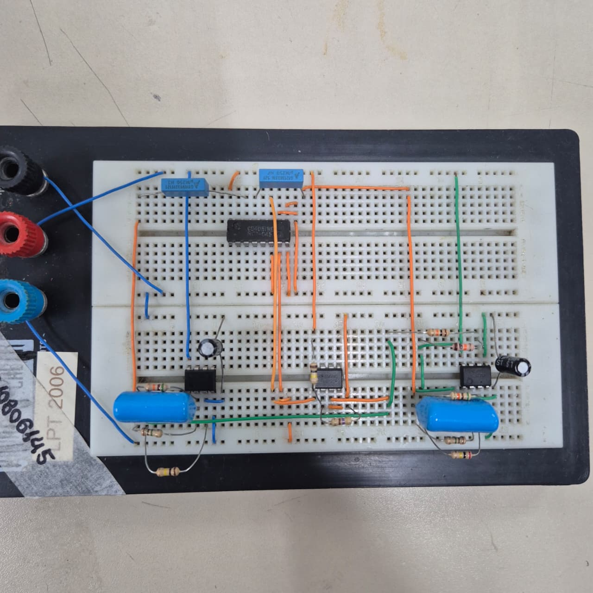
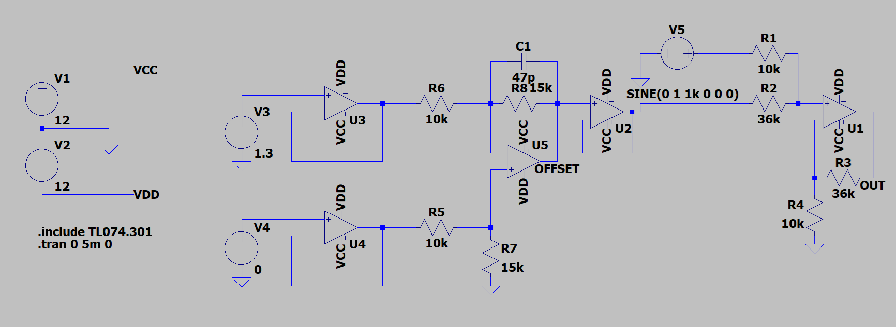
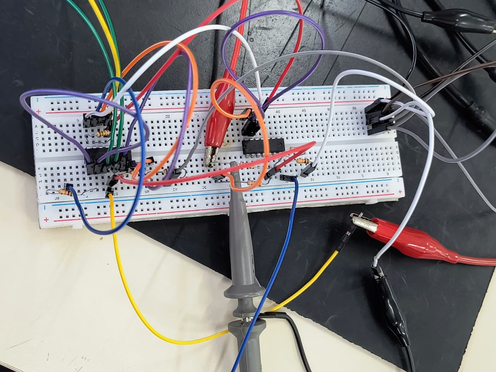
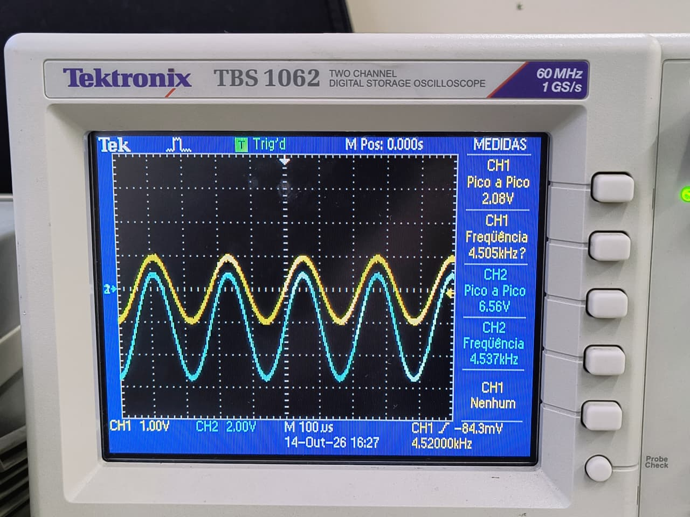
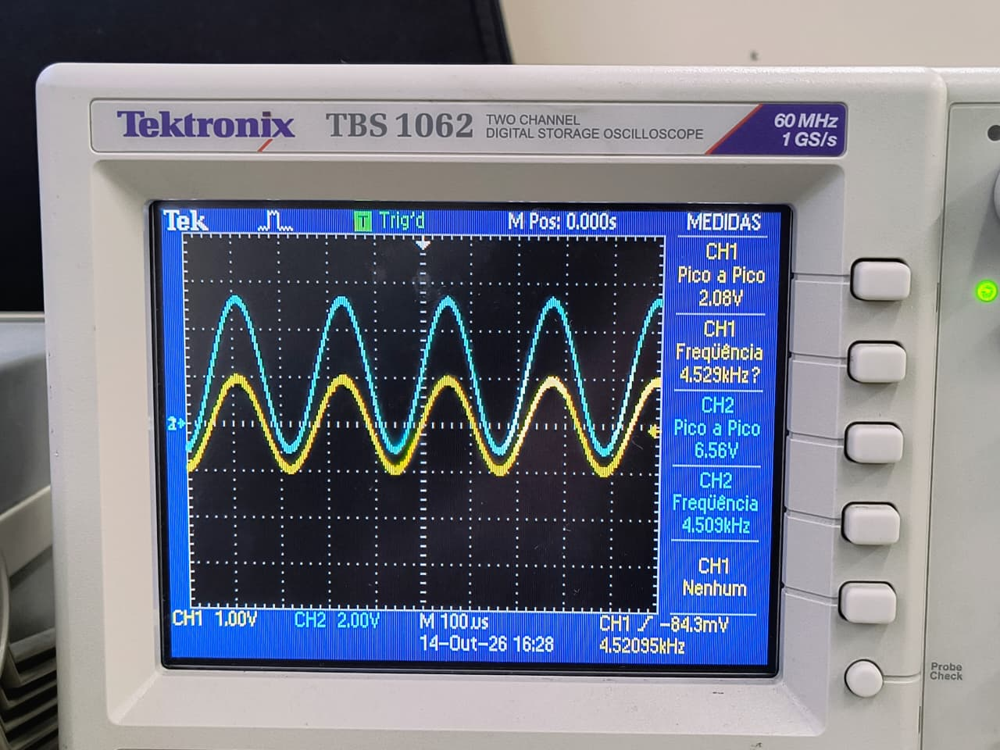
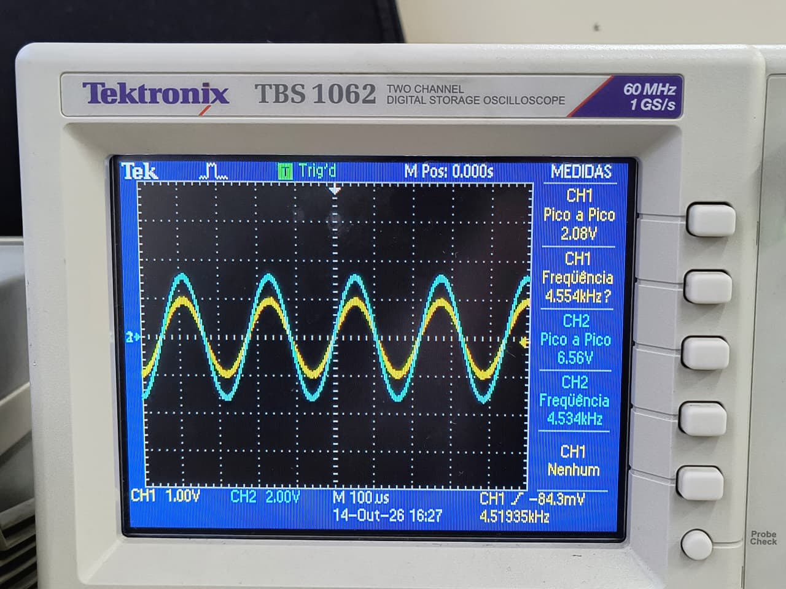
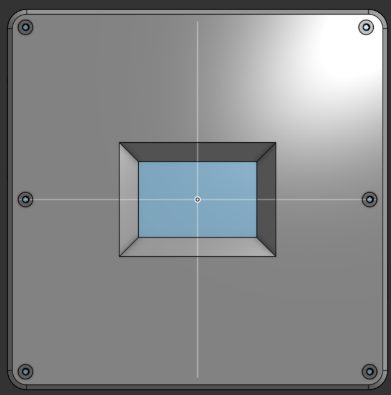
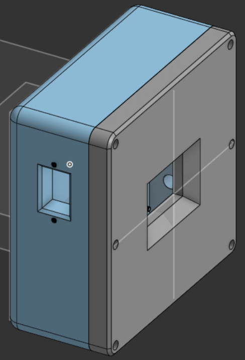
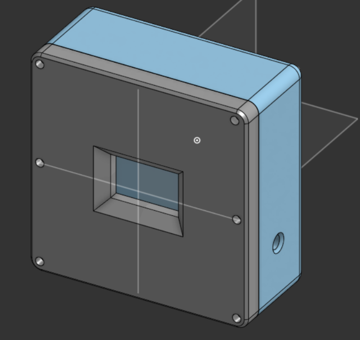
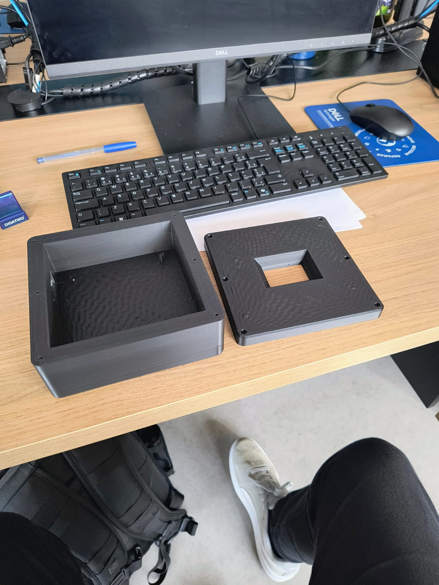

# Etapa 3

Nesta etapa avançamos na implementação física e na consolidação da arquitetura do gerador de funções microcontrolado, integrando o firmware multitarefa na placa de desenvolvimento e desenvolvendo os circuitos analógicos de conformação de sinal. O trabalho compreendeu a integração do sistema operacional de tempo real com os periféricos de conversão, a validação experimental dos circuitos geradores de onda quadrada, triangular e dente de serra em bancada, a revisão do esquemático completo no KiCad e a análise metrológica dos limites operacionais do sistema.

## Desenvolvimento

### 1. Firmware e Integração no Microcontrolador

A arquitetura de software foi consolidada na placa NUCLEO-F439ZI com o microcontrolador STM32F439ZI [7] utilizando o sistema operacional FreeRTOS. A estrutura foi dividida em tarefas concorrentes com prioridades estritas: controle do sinal e sincronização (`SignalControl`), recepção de comandos seriais e telemetria (`SerialControl`), e atualização da interface gráfica com leitura do touchscreen (`Interface`). 

A geração do sinal de onda senoidal e da onda quadrada base utiliza o conversor digital-analógico interno DAC1 (canal 1 no pino PA4) sincronizado pelo temporizador TIM6 em interrupção periódica. A interface gráfica opera em orientação paisagem com o controlador de display, permitindo alterar parâmetros como frequência (1 Hz a 20 kHz), amplitude (até 9,8 Vpp) e ciclo de trabalho. Um canal de conversão analógico-digital (ADC2 no canal 4) foi configurado para executar autotestes internos no nó de saída do DAC. A documentação completa da arquitetura do firmware e das tarefas está disponível em [software/README.md](./software/README.md).

### 2. Geração e Condicionamento Analógico das Formas de Onda

Diante das distorções de atenuação e fase observadas na Etapa 2 ao filtrar ondas com bordas rápidas em filtros de reconstrução, a arquitetura analógica foi dividida em duas vias funcionais: uma malha com filtro passa-baixas Sallen-Key de Bessel para a senoide e uma via analógica dedicada para as formas de onda não senoidais.

A onda quadrada é fornecida pelo DAC, permitindo amplo controle de amplitude e ciclo de trabalho. Para a síntese da onda triangular, empregou-se um circuito integrador ativo baseado no amplificador operacional TL084 [1], que recebe a onda quadrada com ciclo de trabalho fixado em 50% e um nível contínuo de referência de 1,65 V na entrada não-inversora, proporcionando integração simétrica com inclinações idênticas.

A onda dente de serra é produzida a partir de duas ondas triangulares defasadas em 180 graus: a triangular original do integrador e uma versão defasada obtida por um estágio inversor de ganho unitário com TL084 [1]. Ambas são conectadas a um multiplexador analógico CD4051B [2] acoplado em corrente alternada. A própria onda quadrada geradora comuta o canal do multiplexador em sincronia com o sinal, selecionando alternadamente os trechos ascendentes das rampas para compor a dente de serra. 

O protótipo de bancada comprovou a viabilidade prática da topologia, como ilustrado na imagem a seguir:

  

<em>Montagem experimental do estágio analógico gerador de sinais não senoidais.</em>

### 3. Modelagem Matemática e Esquemático no KiCad

Após a validação prática, a modelagem matemática demonstrou que, ao adotar 10 mV como resolução mínima do DAC e exigir excursão de 100 mV a 10 V na saída, um único circuito RC cobre uma janela de frequências restrita a uma razão de 1,5 vezes ($f$ a $1,5f$). Para contemplar de 1 Hz a 20 kHz, seriam necessárias 24,42 malhas discretas. O esquemático integrou essa demanda através de 4 multiplexadores CD4051B [2], permitindo selecionar 32 combinações resistivas com fator de passo de 1,36 vezes. Os cálculos estão detalhados em [hardware/dimensionamento_integrador.md](./hardware/dimensionamento_integrador.md).

O esquemático integrado no KiCad foi organizado hierarquicamente em blocos funcionais (`Supply`, `MCU`, `SineFilter`, `TriangularSawtooth`, `Offset_Amplifier` e `Mux`), com documentação disponível em [hardware/README.md](./hardware/README.md). Durante a revisão técnica, identificou-se que o módulo comercial XL6019 [6] opera em topologia SEPIC de terra comum, impossibilitando a geração do barramento negativo de -12 V sem curto-circuito na alimentação. Devido a essa não conformidade e à complexidade da malha de 32 resistores, optou-se tecnicamente por adiar a confecção da placa de circuito impresso (PCB) definitiva para a Etapa 4, assegurando correções seguras de projeto.

## 4. Estágio de offset e amplificação de saída

O último bloco analógico do gerador é responsável por duas funções: amplificar o sinal vindo do filtro de reconstrução e somar a ele uma tensão contínua de offset definida pelo usuário. O bloco é dividido em dois estágios:

1. **Geração da tensão de offset:** converte duas tensões unipolares fornecidas pelos DACs do microcontrolador (0 a 3,3 V) em uma tensão bipolar entre aproximadamente −5 V e +5 V.
2. **Amplificador somador não-inversor:** amplifica o sinal e soma a tensão de offset em um único amplificador operacional, sem inverter a fase da forma de onda.

Todos os amplificadores operacionais são do tipo TL074 (JFET), alimentados em ±12 V. O circuito completo, utilizado na simulação, é mostrado na Figura 1.

  

<em>Figura 1 — Circuito de geração de offset (U3, U4, U5 e U2) e amplificador somador de saída (U1), simulado no LTspice.</em>

### 4.1. Geração da tensão de offset

#### 4.1.1. Buffers de entrada (U3 e U4)

Cada saída de DAC passa por um seguidor de tensão de ganho unitário. Esses estágios apresentam alta impedância de entrada e baixa impedância de saída, isolando os DACs da malha resistiva seguinte. Assim, o ganho do circuito não depende da impedância de saída dos conversores, e os dois ramos do amplificador diferencial ficam equilibrados. Como os buffers externos cumprem essa função, o buffer interno do DAC do microcontrolador pode ser desabilitado, o que permite utilizar a faixa completa de 0 a 3,3 V.

#### 4.1.2. Amplificador diferencial (U5)

Os resistores R6 e R5 (10 kΩ) e R8 e R7 (15 kΩ) formam um subtrator com ganho diferencial definido pela razão entre eles:

$$
V_{OFFSET} = \frac{R_8}{R_6} \cdot (V_4 - V_3) = 1{,}5 \cdot (V_4 - V_3)
$$

Como cada entrada varia de 0 a 3,3 V, a diferença $V_4 - V_3$ varia de −3,3 V a +3,3 V, resultando em uma tensão de offset entre aproximadamente **−4,95 V e +4,95 V**.

O uso de resistores iguais nos dois ramos ($R_6 = R_5$ e $R_8 = R_7$) garante o cancelamento da componente comum às duas entradas. O capacitor C1 (47 pF), em paralelo com R8, limita a banda do estágio e evita oscilações de alta frequência, sem afetar a resposta em corrente contínua.

#### 4.1.3. Buffer de saída (U2)

Um seguidor de tensão entrega a tensão de offset ao estágio somador, garantindo baixa impedância de saída. Dessa forma, a tensão de offset não é afetada pela carga representada pelo resistor de entrada do somador.

#### 4.1.4. Operação

No firmware, adota-se um DAC para cada polaridade: para offset positivo, ajusta-se $V_4$ e mantém-se $V_3$ em 0 V; para offset negativo, o inverso.

| Componente | Valor | Função |
|---|---|---|
| U3, U4 | TL074 (seguidor) | Buffers de entrada dos DACs |
| R6, R5 | 10 kΩ | Resistores de entrada do subtrator |
| R8, R7 | 15 kΩ | Resistores de realimentação e de referência (ganho 1,5) |
| C1 | 47 pF | Limitação de banda e estabilidade |
| U5 | TL074 | Amplificador diferencial |
| U2 | TL074 (seguidor) | Buffer de saída do offset |

### 4.2. Amplificador somador não-inversor (U1)

O sinal de saída do filtro e a tensão de offset são aplicados, respectivamente, através de R1 (10 kΩ) e R2 (36 kΩ), à entrada não-inversora de U1. Esses dois resistores formam um divisor ponderado, de modo que a tensão na entrada não-inversora é:

$$
V_{+} = \frac{R_2 \cdot V_{SINAL} + R_1 \cdot V_{OFFSET}}{R_1 + R_2}
$$

A malha de realimentação, formada por R3 (36 kΩ) e R4 (10 kΩ), define o ganho não-inversor:

$$
V_{OUT} = \left(1 + \frac{R_3}{R_4}\right) \cdot V_{+}
$$

Combinando as duas expressões e utilizando $R_1 = R_4 = 10\ \text{k}\Omega$ e $R_2 = R_3 = 36\ \text{k}\Omega$:

$$
V_{OUT} = \frac{R_3}{R_4} \cdot V_{SINAL} + V_{OFFSET} = 3{,}6 \cdot V_{SINAL} + V_{OFFSET}
$$

Ou seja, o sinal é amplificado com ganho 3,6, enquanto a tensão de offset é transferida para a saída com ganho unitário. Como a topologia é não-inversora, a forma de onda de saída mantém a mesma fase do sinal de entrada, o que preserva, por exemplo, o sentido da rampa da onda dente de serra.

No projeto da placa, um capacitor de acoplamento de 82 nF é inserido em série com R1. Ele bloqueia o nível DC de aproximadamente 1,65 V presente na saída do DAC, que de outra forma seria multiplicado pelo ganho e deslocaria a saída. Com a resistência vista pelo capacitor ($R_1 + R_2 = 46\ \text{k}\Omega$), a frequência de corte inferior resultante é:

$$
f_c = \frac{1}{2\pi \cdot 46\ \text{k}\Omega \cdot 82\ \text{nF}} \approx 42\ \text{Hz}
$$

bem abaixo da menor frequência de operação do gerador.

| Componente | Valor | Função |
|---|---|---|
| R1 | 10 kΩ | Entrada do sinal |
| R2 | 36 kΩ | Entrada do offset |
| R3 | 36 kΩ | Realimentação |
| R4 | 10 kΩ | Realimentação para o GND |
| C de acoplamento | 82 nF | Bloqueio do nível DC do sinal (placa final) |
| U1 | TL074 | Amplificador somador não-inversor |

**Limite de excursão.** No pior caso, um sinal de ±1,65 V multiplicado por 3,6 (±5,9 V), somado a um offset de ±4,95 V, resulta em cerca de ±10,9 V, próximo ao limite de saída do TL074 alimentado em ±12 V. Por isso, o firmware deve limitar a combinação de amplitude e offset para evitar a saturação do amplificador.

### 4.3. Simulação

Na simulação da Figura 1, a fonte V5 representa o sinal filtrado (senoide de 1 V de pico, 1 kHz), e as fontes V3 = 1,3 V e V4 = 0 V representam as saídas dos DACs. A tensão de offset esperada é:

$$
V_{OFFSET} = 1{,}5 \cdot (0 - 1{,}3) = -1{,}95\ \text{V}
$$

e a saída esperada é uma senoide de $3{,}6 \cdot 1 = 3{,}6\ \text{V}$ de pico, centrada em −1,95 V.

### 4.4. Resultados em bancada

O circuito foi montado em protoboard, conforme a Figura 2, e alimentado com fonte simétrica de ±12 V. Como sinal de entrada, utilizou-se um gerador de funções com senoide de aproximadamente 2,08 V pico a pico e 4,5 kHz. Nas medições, o canal 1 (amarelo) corresponde ao sinal de entrada e o canal 2 (azul) à saída do amplificador.

  

<em>Figura 2 — Montagem em protoboard dos estágios de offset e amplificação.</em>

As Figuras 3, 4 e 5 mostram a saída para três valores de offset: negativo, positivo e nulo. Em todos os casos, a amplitude de saída é de 6,56 V pico a pico, e apenas o nível DC da forma de onda é deslocado, o que confirma o funcionamento independente das duas entradas do somador.

  

<em>Figura 3 — Saída com offset negativo (aproximadamente −2 V). CH1: 1 V/div; CH2: 2 V/div; base de tempo: 100 µs/div.</em>

  

<em>Figura 4 — Saída com offset positivo (aproximadamente +2 V). CH1: 1 V/div; CH2: 2 V/div; base de tempo: 100 µs/div.</em>

  

<em>Figura 5 — Saída com offset nulo. CH1: 1 V/div; CH2: 2 V/div; base de tempo: 100 µs/div.</em>

O ganho medido do sinal foi:

$$
G_{medido} = \frac{6{,}56\ \text{V}_{pp}}{2{,}08\ \text{V}_{pp}} \approx 3{,}15
$$

valor cerca de 12 % abaixo do ganho teórico de 3,6. As causas prováveis são a tolerância dos resistores utilizados na montagem e a imprecisão da medida automática de pico a pico do osciloscópio, que inclui o ruído do sinal. Recomenda-se conferir os valores de R1 a R4 com multímetro e, se necessário, corrigir o ganho por calibração no firmware. Os valores de offset indicados nas legendas foram estimados a partir da posição das formas de onda em relação à referência de 0 V do canal 2.

## 5. Gabinete (case) do gerador de funções

O gabinete foi modelado em CAD 3D para abrigar todos os módulos do gerador: a fonte de alimentação, as placas de condicionamento analógico, o microcontrolador e a interface com o usuário. O formato é um prisma de base quadrada com arestas arredondadas, composto por um corpo principal e um painel frontal removível.

### 5.1. Painel frontal

O painel frontal concentra a interação com o usuário. No centro há uma abertura retangular para o display LCD touchscreen, com bordas chanfradas (em forma de moldura), como mostra a Figura 1. O chanfro amplia o ângulo de visão da tela e facilita o toque nas regiões próximas às bordas, além de dar acabamento à abertura.

O painel é fixado ao corpo por seis parafusos, nos quatro cantos e no centro das laterais esquerda e direita. Essa distribuição mantém o painel bem apoiado, evita que ele se deforme com a pressão do toque na tela e permite removê-lo para acessar o interior durante a montagem e a manutenção.

  

<em>Figura 1 — Vista frontal do gabinete, com a abertura chanfrada do display LCD e os seis furos de fixação do painel.</em>

### 5.2. Lateral esquerda: entrada de alimentação

A abertura retangular na lateral esquerda, mostrada na Figura 2, recebe a tomada de entrada da rede elétrica (220 V), do tipo conector de painel. Os dois furos acima e abaixo da abertura são para os parafusos de fixação do conector. A entrada alimenta a fonte chaveada isolada (HLK-PM12), da qual derivam as tensões de +12 V, −12 V e +5 V do sistema.

  

<em>Figura 2 — Lateral esquerda do gabinete, com a abertura para a tomada de entrada da rede elétrica (220 V) e os furos de fixação do conector.</em>

### 5.3. Lateral direita: saída de sinal

O furo circular na lateral direita, mostrado na Figura 3, é destinado ao conector coaxial (BNC) de saída, por onde o sinal gerado é entregue ao equipamento externo. O uso de conector coaxial é o padrão em instrumentação, pois permite a ligação direta a osciloscópios e outros instrumentos de bancada com cabo blindado.

  

<em>Figura 3 — Vista em perspectiva do gabinete, com o furo para o conector coaxial (BNC) de saída na lateral direita.</em>

### 5.4. Disposição geral

A separação entre a entrada de energia (lado esquerdo) e a saída de sinal (lado direito) mantém os cabos da rede elétrica afastados do caminho do sinal analógico, reduzindo o acoplamento de ruído da rede na saída do gerador.

### 5.5. Protótipo impresso

O gabinete foi fabricado por impressão 3D, em duas peças independentes: o corpo principal e o painel frontal, mostrados lado a lado na Figura 4. A impressão permitiu verificar as dimensões reais das peças, o encaixe do painel frontal no corpo, o alinhamento dos furos de fixação e as medidas da abertura do display antes da montagem final dos componentes.

  

<em>Figura 4 — Gabinete impresso em 3D: corpo principal (à esquerda) e painel frontal com a abertura do display (à direita).</em>

## Testes

Os testes laboratoriais validaram individualmente os blocos funcionais do gerador:

| Subsistema avaliado | Resultado | Observações metrológicas |
|:--|:-:|:--|
| Firmware FreeRTOS e DAC | Aprovado | Execução estável das tasks, autoteste via ADC2 com 305 mVpp a 1 kHz |
| Touchscreen e display | Aprovado | Navegação, ajuste de parâmetros e botões operando sem travamento |
| Circuito integrador triangular | Aprovado | Rampas simétricas e lineares comprovadas em osciloscópio |
| Gerador de onda dente de serra | Aprovado | Comutação síncrona por CD4051B validada em duas amplitudes |
| Filtro de reconstrução senoidal | Aprovado | Atenuação adequada de harmônicas discretas do DAC em bancada |
| Fonte chaveada SEPIC (XL6019) | Reprovado | Terra comum inviabiliza -12 V; requer fonte com isolação galvânica |

Os testes confirmaram a solidez do firmware e a conformação de todas as formas de onda analógicas. A reprogramação da malha resistiva e a readequação da fonte simétrica constituem as diretrizes prioritárias para a entrega da PCB na Etapa 4.

## Referências (links/datasheets/livros)

1. [Texas Instruments — TL084 JFET-Input Operational Amplifier Datasheet](https://www.ti.com/lit/ds/symlink/tl084.pdf)
2. [Texas Instruments — CD4051B CMOS Analog Multiplexer/Demultiplexer Datasheet](https://www.ti.com/lit/ds/symlink/cd4051b.pdf)
3. [Texas Instruments — TL081 JFET-Input Operational Amplifier Datasheet](https://www.ti.com/lit/ds/symlink/tl081.pdf)
4. [Hi-Link — HLK-PM05 AC-DC 5V 3W Power Supply Module](https://hlktech.net/index.php?id=109)
5. [Aerosemi — MT3608 2A Step Up Converter Datasheet](https://www.olimex.com/Products/Breadboarding/BB-PWR-3608/resources/MT3608.pdf)
6. [XLSEMI — XL6019 5A Buck-Boost DC-DC Converter Datasheet](https://www.xlsemi.com/datasheet/XL6019-CN.pdf)
7. [STMicroelectronics — STM32F439ZI Datasheet DS9484](https://www.st.com/resource/en/datasheet/stm32f439zi.pdf)
8. SEDRA, Adel S.; SMITH, Kenneth C. *Microeletrônica*. 7. ed. São Paulo: Pearson Education do Brasil, 2017.
