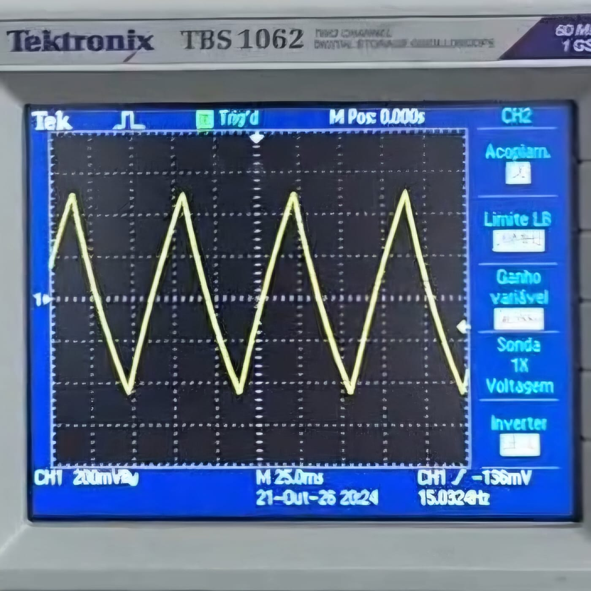
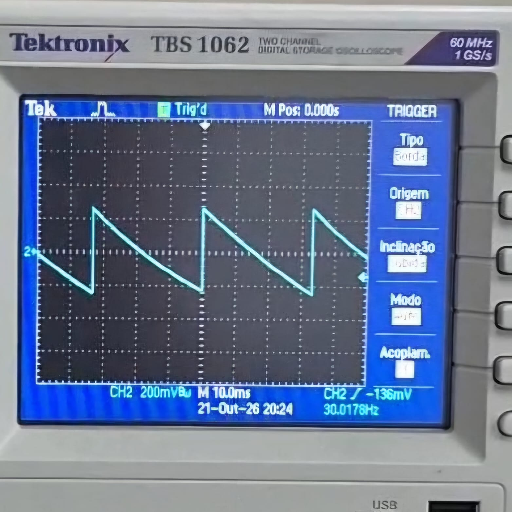
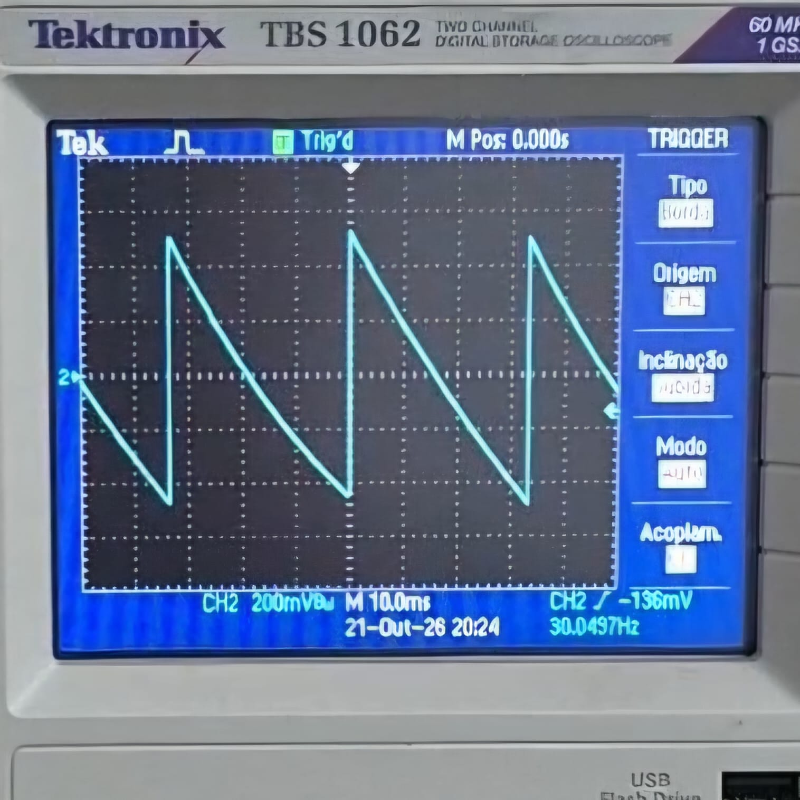

# Hardware da Etapa 3

Este documento apresenta o desenvolvimento, os testes laboratoriais e a modelagem do estágio analógico de conformação de sinais da Etapa 3 do Gerador de Função Microcontrolado. O foco principal concentrou-se na via analógica dedicada à síntese das formas de onda triangular e dente de serra, bem como no esquemático integrado no KiCad.

---

## 1. Concepção da Arquitetura e Separação de Vias

Na Etapa 2, constatou-se que o filtro de reconstrução ativo passa-baixas de Bessel provocava atenuações assimétricas e distorções severas de transição em sinais não senoidais. Em decorrência desse resultado experimental, adotou-se a separação do condicionamento em vias independentes de hardware:
* **Via Senoidal:** Canal dedicado composto pelo filtro de reconstrução Sallen-Key de Bessel, dimensionado para suavizar os degraus do conversor digital-analógico (DAC);
* **Via Quadrada, Triangular e Dente de Serra:** Canal analógico independente, livre da filtragem passa-baixa, preservando tempos de subida e descida reduzidos.

### 1.1. Onda Quadrada
A forma de onda quadrada não necessita de processamento por integrador. Ela é gerada pelo DAC do microcontrolador (ou via chaveamento de pino digital com temporizador), permitindo seleção flexível de frequência, amplitude e ciclo de trabalho.

### 1.2. Onda Triangular
A onda triangular é gerada a partir da integração temporal de uma onda quadrada com *duty cycle* rigorosamente fixado em $50\%$. O sinal é aplicado à entrada inversora de um circuito integrador ativo baseado no amplificador operacional `TL084` [1]. Para garantir que a saída integre de forma simétrica em torno do zero de referência, aplica-se à entrada não-inversora do amplificador um nível DC de $1,65\text{ V}$ (metade da excursão máxima de $3,3\text{ V}$ do DAC). Como o tempo em nível alto é idêntico ao tempo em nível baixo, a rampa resultante oscila com inclinações positiva e negativa de módulos rigorosamente iguais.

### 1.3. Onda Dente de Serra
A síntese da onda dente de serra foi concebida a partir de duas ondas triangulares em oposição de fase. A primeira triangular é proveniente da saída do integrador; a segunda é gerada aplicando-se essa mesma rampa à entrada de um amplificador inversor com ganho unitário configurado no `TL084` [1]. Ambos os sinais passam por pequenos capacitores de acoplamento para eliminação de níveis contínuos e são conectados aos canais de entrada de um multiplexador analógico bidirecional `CD4051B` [2]. O pino de seleção de canal do multiplexador é acionado em sincronia direta pela própria onda quadrada geradora do circuito: quando a quadrada está em nível alto, o multiplexador comuta para a rampa ascendente da primeira onda; quando a quadrada transita para nível baixo, o multiplexador conecta a rampa ascendente correspondente da onda invertida, formando uma onda dente de serra contínua.

---

## 2. Validação Experimental em Bancada

Para validar a viabilidade física da topologia antes de calcular os valores finais de componentes para toda a faixa de operação, realizou-se a montagem do protótipo em bancada. Injetou-se uma onda quadrada de $50\%$ de ciclo de trabalho a partir de um gerador de funções de laboratório para alimentar o circuito composto por AmpOps `TL084` e a chave analógica `CD4051B`.

A montagem prática executada na bancada de ensaios pode ser observada na imagem a seguir.

  

<em>Montagem física em bancada dos circuitos de teste da onda triangular e dente de serra.</em>

A conformação da onda triangular foi validada com sucesso na saída do primeiro estágio integrador, exibindo excelente linearidade de rampa e simetria temporal, conforme ilustrado no registro do osciloscópio abaixo.

  

<em>Forma de onda triangular medida na saída do circuito integrador em ensaio de bancada.</em>

Em seguida, avaliou-se a saída do multiplexador analógico comutado pela onda quadrada para validar a síntese da dente de serra. O circuito respondeu de forma estável, permitindo inclusive o controle direto da amplitude da dente de serra através do ajuste de amplitude do sinal de entrada, como demonstram as duas capturas de tela seguintes para patamares distintos de tensão.

  

<em>Onda dente de serra gerada para o primeiro nível de amplitude de entrada.</em>

  

<em>Onda dente de serra gerada para um segundo patamar de amplitude, comprovando a linearidade do estágio.</em>

---

## 3. Dimensionamento Teórico e Limitações Metrológicas

Com a prova de conceito comprovada em bancada, realizou-se a modelagem matemática para dimensionar os componentes passivos frente às especificações nominais do projeto ($1\text{ Hz}$ a $20\text{ kHz}$ e $100\text{ mV}$ a $10\text{ V}$).

A dedução matemática demonstrou que, ao se fixar a resolução prática do DAC em $10\text{ mV}$ e admitir uma excursão útil de entrada de $1,5\text{ V}$, a razão dinâmica $\alpha_{\text{máx}} / \alpha_{\text{mín}}$ para um par $RC$ fixo fica limitada em $150$. Substituindo a excursão de amplitude demandada na saída, conclui-se que **um único conjunto RC cobre apenas uma janela de frequência proporcional a $1,5\times$ ($f_{\text{máx}} = 1,5 \cdot f_{\text{mín}}$)**.

Para varrer continuamente todo o intervalo de $1\text{ Hz}$ a $20\text{ kHz}$, o cálculo resultou na necessidade estrita de $24,42$ combinações resistivas. No esquemático, essa demanda foi solucionada com 4 multiplexadores `CD4051B` [2], totalizando 32 canais de seleção com razão de passo de $1,36\times$. 

A dedução algébrica detalhada e o memorial de cálculo encontram-se disponíveis em:
* [Memorial de Dimensionamento e Limitações do Integrador](./dimensionamento_integrador.md)

---

## 4. Projeto no KiCad e Esquemático Integrado

O esquemático completo foi projetado no software KiCad (v10) e estruturado em folhas hierárquicas, disponível no arquivo de documentação [Sch/GeradorDeOnda.pdf](../../Sch/GeradorDeOnda.pdf). A organização dos arquivos no repositório compreende:
* `GeradorDeOnda.kicad_sch`: Folha principal de interconexão entre os subsistemas;
* `Supply.kicad_sch`: Estágio de entrada com módulo AC-DC isolado `HLK-PM05` ($5\text{ V}$) [4], conversor boost `MT3608` ($+12\text{ V}$) [5] e conversor `XL6019` [6];
* `MCU.kicad_sch`: Pinagem de E/S e canais analógicos da placa `NUCLEO-F439ZI` (`STM32F439ZI`) [7];
* `SineFilter.kicad_sch`: Filtro de reconstrução ativo passa-baixas Sallen-Key de 4ª ordem baseado em `TL084` [1];
* `TriangularSawtooth.kicad_sch`: Malha de seleção de 32 resistores por chaves `CD4051B` [2], integradores para faixas de baixa e alta frequência e amplificadores inversores com `TL084` [1];
* `Offset_Amplifier.kicad_sch`: Circuito somador/subtrator de offset com `TL084` [1] e amplificador de potência de saída com `TL081` [3];
* `Mux.kicad_sch`: Multiplexador analógico de seleção final da forma de onda entregue aos bornes de saída;
* `Components/`: Modelos 3D (`MT3608_Module.STEP`), bibliotecas de símbolos e footprints dedicados para os módulos e conectores da placa.

### 4.1. Análise Crítica e Decisões de Manufatura
Durante a revisão criteriosa do esquemático na Etapa 3, identificou-se uma incompatibilidade crítica no módulo comercial de alimentação `U3` (`XL6019`). Os módulos de 4 pinos comercializados como buck-boost utilizam a topologia SEPIC não isolada, possuindo o plano de terra da entrada (`IN-`) em curto-circuito físico direto com o terra de saída (`OUT-`). A tentativa de gerar $-12\text{ V}$ invertendo a polaridade dos bornes provoca curto-circuito direto entre o barramento negativo e o terra geral ($0\text{V}$) da fonte e do computador conectado via USB.

Somada à expressiva complexidade de roteamento imposta pelos 32 resistores de comutação dos integradores, essa restrição de alimentação levou à decisão técnica de **não manufaturar a placa de circuito impresso (PCB) definitiva nesta etapa**. Priorizou-se a validação funcional individual de todos os blocos em bancada, postergando a confecção da PCB para a Etapa 4 após a incorporação de uma fonte simétrica com isolação galvânica adequada.

---

## 5. Blocos Complementares do Sistema

Os demais subsistemas analógicos desenvolvidos pela equipe completam a cadeia de sinal do equipamento:
* **Filtro Senoidal:** Estruturado a partir de células Sallen-Key ativas com amplificadores operacionais `TL084`, projetado para atenuar harmônicas superiores e reconstruir com suavidade a senoide gerada pelo DAC;
* **Estágio de Offset e Amplificação:** Composto por um estágio subtrator diferencial para aplicação de tensão contínua ajustável ($-5\text{ V}$ a $+5\text{ V}$) e um estágio de saída com ganho de $3,5\times$ baseado em `TL081` [3], permitindo excursão de sinal até aproximadamente $10\text{ V}_{\text{pp}}$;
* **Fonte de Alimentação Primária:** Alimentada pela rede de $220\text{ V}_{\text{AC}}$, baseada no módulo conversor isolado `HLK-PM05` [4] para distribuição dos $5\text{ V}$ da lógica e conversores chaveados para os trilhos dos amplificadores.

---

## Referências (links/datasheets/livros)

1. [Texas Instruments — TL084 JFET-Input Operational Amplifier Datasheet](https://www.ti.com/lit/ds/symlink/tl084.pdf)
2. [Texas Instruments — CD4051B CMOS Single 8-Channel Analog Multiplexer/Demultiplexer Datasheet](https://www.ti.com/lit/ds/symlink/cd4051b.pdf)
3. [Texas Instruments — TL081 JFET-Input Operational Amplifier Datasheet](https://www.ti.com/lit/ds/symlink/tl081.pdf)
4. [Hi-Link — HLK-PM05 AC-DC 5V 3W Power Supply Module](https://hlktech.net/index.php?id=109)
5. [Aerosemi — MT3608 2A Step Up Converter Datasheet](https://www.olimex.com/Products/Breadboarding/BB-PWR-3608/resources/MT3608.pdf)
6. [XLSEMI — XL6019 5A 180KHz 40V Buck-Boost DC-DC Converter Datasheet](https://www.xlsemi.com/datasheet/XL6019-CN.pdf)
7. [STMicroelectronics — STM32F439ZI Datasheet DS9484](https://www.st.com/resource/en/datasheet/stm32f439zi.pdf)
8. SEDRA, Adel S.; SMITH, Kenneth C. *Microeletrônica*. 7. ed. São Paulo: Pearson Education do Brasil, 2017.
