# Hardware da Etapa 3

O desenvolvimento do hardware concentrou-se nos blocos analógicos que recebem os sinais gerados pelo STM32F439ZI [4] e realizam a conversão, o condicionamento e a seleção da forma de onda. A arquitetura separa o caminho senoidal do caminho das formas não senoidais, pois os testes da Etapa 2 mostraram que um único filtro de reconstrução não preservava adequadamente sinais com transições rápidas.

Nesta etapa, o filtro senoidal foi ensaiado com o DAC do STM32 na faixa de 1 Hz a 20 kHz. Os demais blocos analógicos foram avaliados separadamente em bancada. Também foi elaborado um esquemático hierárquico no KiCad e produzido um protótipo impresso do gabinete.

## Desenvolvimento

### Arquitetura de geração das formas de onda

A senoide é produzida diretamente pelo DAC do microcontrolador e passa por um filtro próprio. A onda quadrada também sai do DAC e segue diretamente ao estágio de seleção previsto no esquemático. Para gerar as ondas triangular e dente de serra, o firmware fornece uma onda quadrada com ciclo de trabalho fixo em 50% aos circuitos de conversão analógica.

O integrador ativo utiliza amplificadores operacionais TL084 [1]. A entrada não inversora recebe uma referência de 1,65 V, correspondente ao centro da excursão de 0 a 3,3 V do DAC. Assim, a diferença aplicada ao integrador alterna de forma aproximadamente simétrica e produz rampas ascendentes e descendentes.

A onda dente de serra é obtida a partir de duas triangulares defasadas em 180 graus. A primeira vem diretamente do integrador e a segunda passa por um inversor de ganho unitário. Um multiplexador analógico CD4051B [2], comutado em sincronismo com a onda quadrada, seleciona alternadamente trechos das duas rampas.

A montagem da Figura 1 recebeu a onda quadrada de um gerador de funções de laboratório. Os registros mostram o comportamento dessa montagem analógica em bancada.

  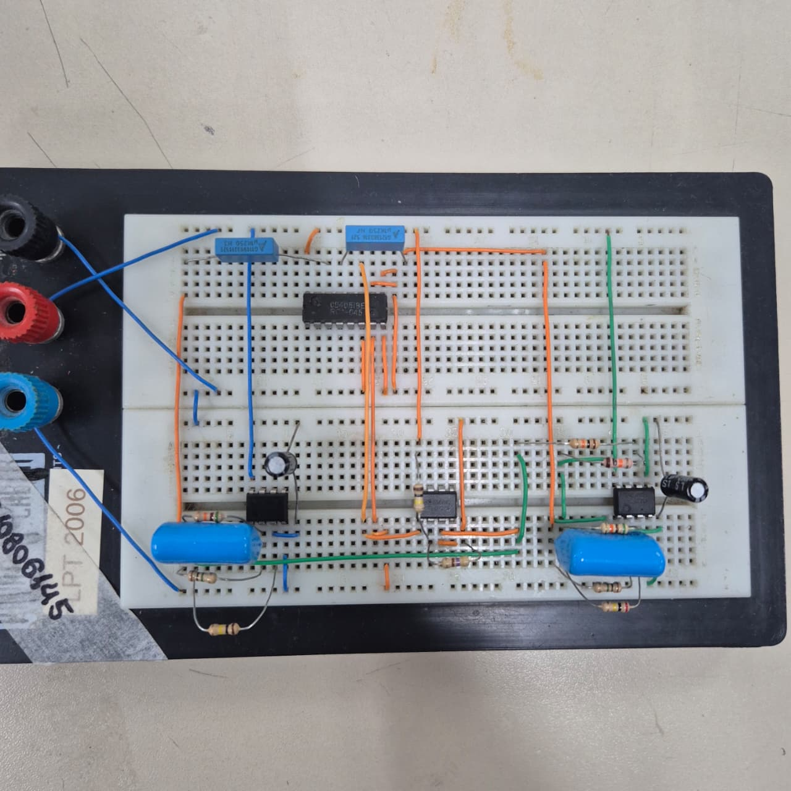

<em>Figura 1 — Montagem experimental do integrador, inversor e multiplexador usados na geração das formas não senoidais.</em>

A saída do integrador apresentou rampas aproximadamente lineares e simétricas a cerca de 15 Hz, como mostra a Figura 2.

  

<em>Figura 2 — Onda triangular de aproximadamente 15 Hz na saída do integrador.</em>

As Figuras 3 e 4 registram a saída do multiplexador a cerca de 30 Hz, em dois níveis de amplitude. A forma dente de serra foi mantida enquanto a amplitude do sinal de entrada foi alterada. Em frequências mais altas, como 20 kHz, a triangular e o dente de serra apresentaram distorção na montagem ensaiada.

  

<em>Figura 3 — Onda dente de serra obtida no primeiro nível de amplitude avaliado.</em>

  

<em>Figura 4 — Onda dente de serra obtida após o aumento da amplitude de entrada.</em>

### Dimensionamento do integrador

Para uma onda quadrada com duty cycle de 50%, a saída do integrador percorre a excursão pico a pico durante metade do período. A taxa de variação necessária pode ser relacionada à amplitude desejada e à frequência conforme o modelo de integrador ativo [5]. Ao considerar uma resolução prática mínima de 10 mV para o controle e uma excursão útil de 1,5 V em torno da referência, obteve-se uma razão dinâmica de 150 para uma mesma malha RC.

Com a faixa de saída estipulada entre 0,1 V e 10 V, essa razão permite que um conjunto RC cubra apenas uma faixa de frequência cujo limite superior é aproximadamente 1,5 vezes o limite inferior. A cobertura contínua de 1 Hz a 20 kHz exigiria, pelo modelo adotado, pelo menos 25 combinações discretas. O esquemático prevê quatro CD4051B, totalizando 32 canais resistivos e uma razão aproximada de 1,36 entre faixas adjacentes.

A dedução e as hipóteses estão no [memorial de dimensionamento do integrador](./dimensionamento_integrador.md). A seleção das 32 combinações consta no esquemático. Os ensaios de bancada registrados acima usaram a montagem experimental.

### Estágio de offset e amplificação

O estágio final foi projetado com amplificadores TL084 e TL081 [1][3] para amplificar o sinal e somar uma tensão contínua de offset. O circuito é dividido em buffers de entrada, amplificador diferencial para geração do offset, buffer de saída e somador não inversor. A simulação utilizada no desenvolvimento é apresentada na Figura 5.

  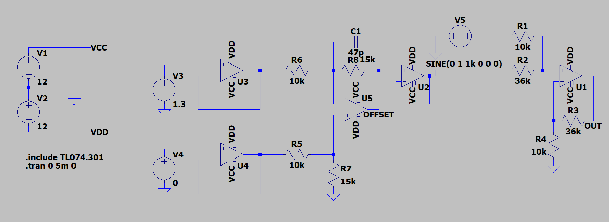

<em>Figura 5 — Circuito de geração de offset e amplificação de saída simulado no LTspice.</em>

No bloco de offset, duas tensões unipolares passam por seguidores de tensão e são aplicadas a um amplificador diferencial. Com resistores de 10 kΩ nas entradas e 15 kΩ na realimentação e na referência, o ganho diferencial teórico é 1,5. Dessa forma, uma diferença de −3,3 V a +3,3 V entre as entradas corresponde a um offset teórico de aproximadamente −4,95 V a +4,95 V.

O somador não inversor utiliza resistores de 10 kΩ e 36 kΩ. A relação teórica resulta em ganho de 3,6 para o sinal e ganho unitário para o offset. O firmware usa 3,5 como ganho conservador, e o ensaio em protoboard indicou ganho de aproximadamente 3,15.

O projeto inclui um capacitor de acoplamento de 82 nF em série com a entrada do sinal. Com resistência equivalente de 46 kΩ, a frequência de corte calculada é próxima de 42 Hz. Como esse valor é superior ao limite inferior pretendido de 1 Hz, a combinação não atende toda a faixa especificada e precisa ser revista antes da integração final. O capacitor bloqueia a componente contínua de aproximadamente 1,65 V presente na saída do DAC, mas também atenua sinais de baixa frequência.

A Figura 6 mostra o circuito montado em protoboard. Para o ensaio, a montagem recebeu alimentação de bancada de ±12 V e uma senoide de aproximadamente 2,08 Vpp a 4,5 kHz, fornecida por um gerador de funções de laboratório.

  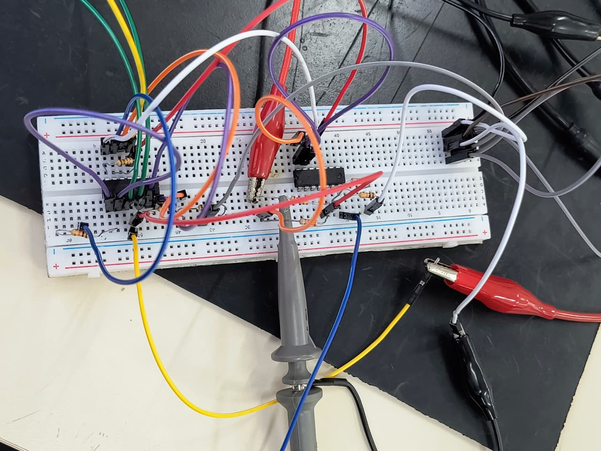

<em>Figura 6 — Montagem em protoboard dos estágios de offset e amplificação.</em>

As Figuras 7, 8 e 9 mostram deslocamentos negativo, nulo e positivo. Em todas, o canal 1 em amarelo é a entrada, e o canal 2 em azul é a saída. A amplitude de saída permaneceu próxima de 6,56 Vpp enquanto o nível contínuo mudou.

  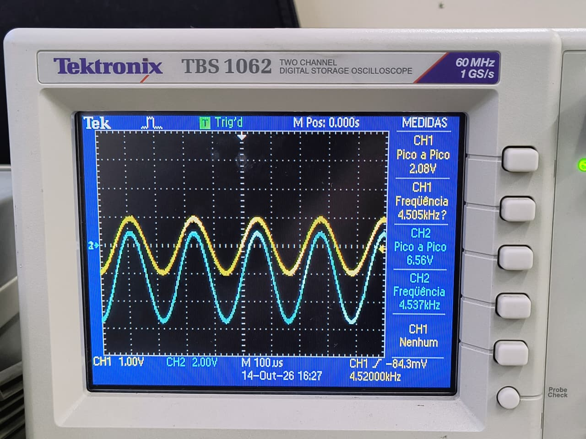

<em>Figura 7 — Saída amplificada com offset negativo.</em>

  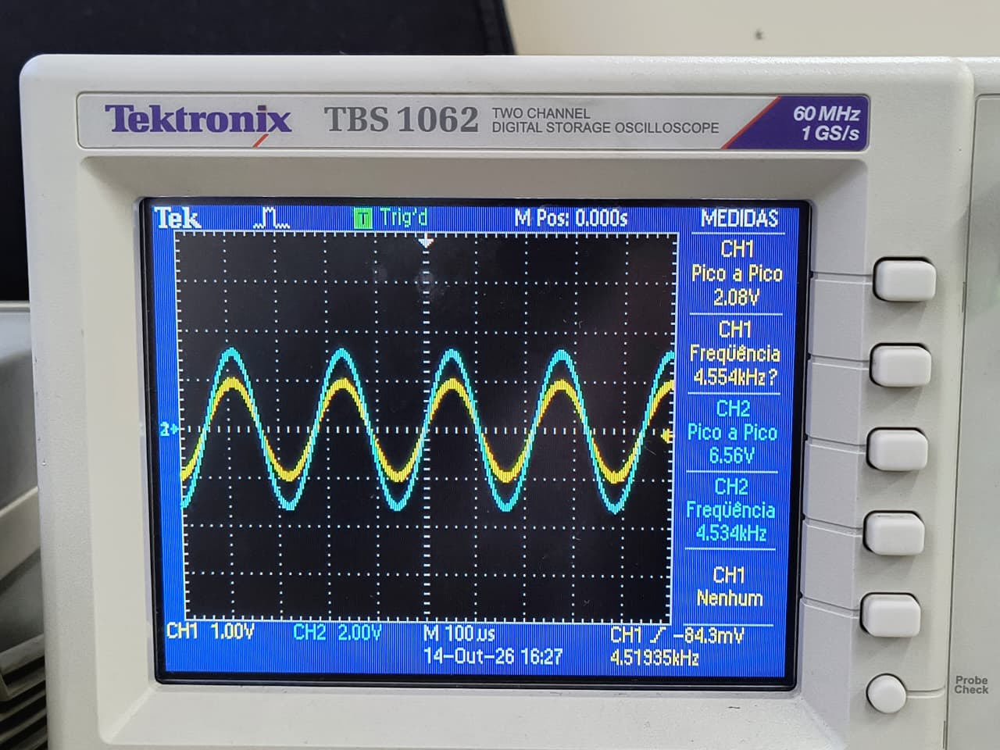

<em>Figura 8 — Saída amplificada com offset nulo.</em>

  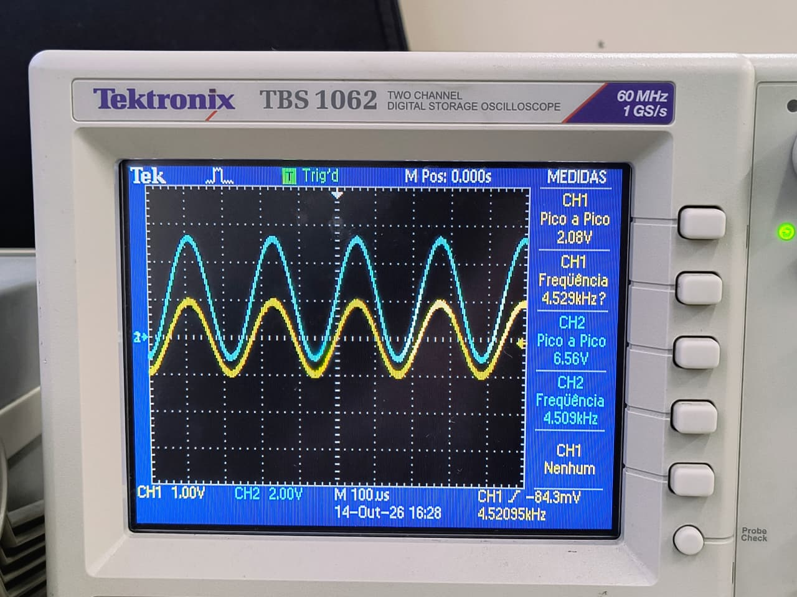

<em>Figura 9 — Saída amplificada com offset positivo.</em>

O ganho experimental foi calculado pela razão entre 6,56 Vpp na saída e 2,08 Vpp na entrada, resultando em aproximadamente 3,15. A diferença de cerca de 12% em relação ao ganho teórico de 3,6 pode estar associada às tolerâncias dos resistores e às incertezas da medição. Os valores de offset foram estimados pela posição das formas de onda em relação à referência de zero do osciloscópio.

O firmware da Etapa 3 apenas valida e armazena o valor de offset selecionado na interface. Os ensaios deste circuito utilizaram fontes externas e não representam atuação elétrica do offset comandada pelo STM32.

### Esquemático no KiCad

O projeto foi organizado em folhas hierárquicas no KiCad. A folha principal está disponível em [`GeradorDeOnda.kicad_sch`](./WaveFormGenerator/GeradorDeOnda.kicad_sch), e o projeto completo pode ser aberto por [`GeradorDeOnda.kicad_pro`](./WaveFormGenerator/GeradorDeOnda.kicad_pro). As folhas estão divididas por função:

| Folha | Conteúdo principal |
|:--|:--|
| `Supply.kicad_sch` | Estudo da alimentação |
| `MCU.kicad_sch` | Conexões da NUCLEO-F439ZI |
| `SineFilter.kicad_sch` | Filtro ativo do caminho senoidal |
| `TriangularSawtooth.kicad_sch` | Integradores, inversores e seleção resistiva |
| `Offset_Amplifier.kicad_sch` | Geração do offset e amplificação |
| `Mux.kicad_sch` | Seleção analógica da forma de onda |

O layout da PCI não foi finalizado nesta etapa. O terra comum do módulo XL6019 avaliado era incompatível com a ligação prevista para obter −12 V. A revisão da alimentação e a complexidade da malha de 32 resistores motivaram o adiamento da fabricação da PCI até a Etapa 4. Na revisão com o KiCad, a verificação de regras elétricas sinalizou a conexão entre duas saídas de alimentação na folha `Supply`, nos componentes U1 e U3.

### Gabinete

O gabinete foi modelado para acomodar o microcontrolador, o display, os circuitos analógicos e os conectores. O painel frontal removível, apresentado na Figura 10, possui abertura chanfrada para o display e seis pontos de fixação, distribuídos para resistir à pressão aplicada durante o uso do touchscreen.

  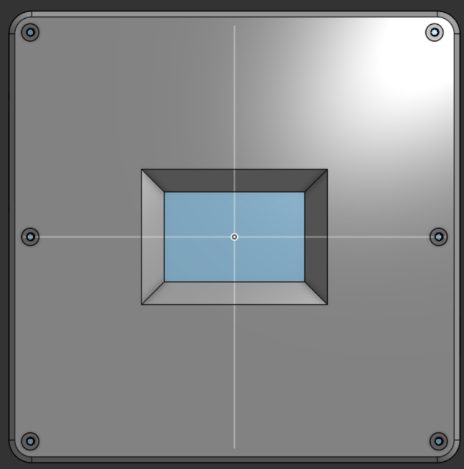

<em>Figura 10 — Painel frontal com abertura para o display e furos de fixação.</em>

As laterais das Figuras 11 e 12 foram reservadas para a entrada de alimentação e para o conector BNC de saída, mantendo os caminhos fisicamente separados.

  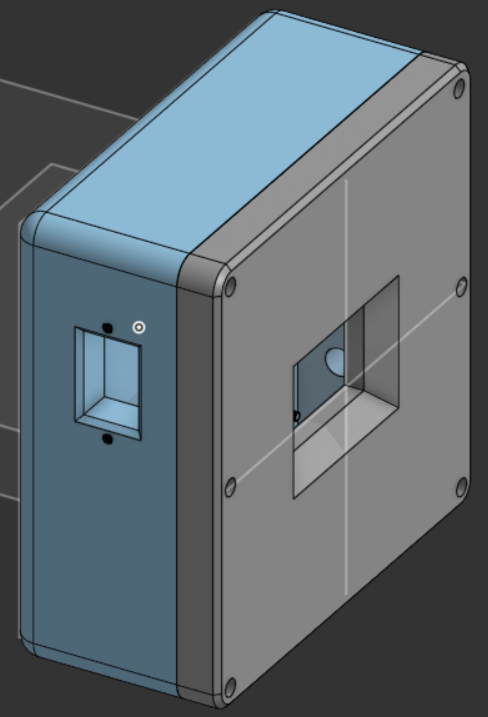

<em>Figura 11 — Lateral esquerda com abertura para o conector de alimentação.</em>

  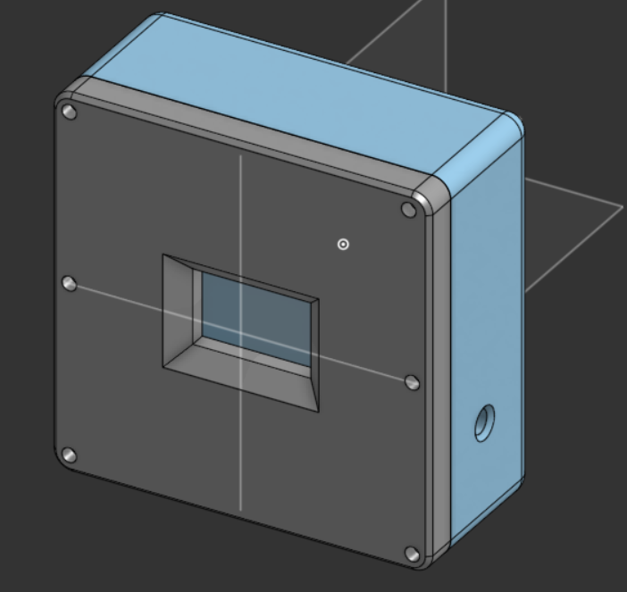

<em>Figura 12 — Lateral direita com abertura para o conector BNC de saída.</em>

O corpo e o painel frontal foram impressos em peças separadas, como mostra a Figura 13. A impressão permitiu verificar dimensões, encaixe, alinhamento dos furos e abertura do display antes da montagem dos componentes.

  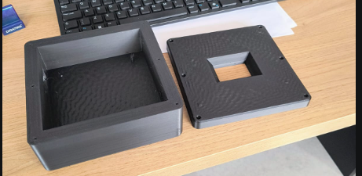

<em>Figura 13 — Protótipo do gabinete impresso em 3D.</em>

## Testes

| Subsistema avaliado | Resultado | Escopo da validação |
|:--|:-:|:--|
| Integrador triangular | Forma observada a cerca de 15 Hz | Rampas aproximadamente lineares e simétricas. Houve distorção a 20 kHz. |
| Gerador de dente de serra | Forma observada a cerca de 30 Hz | Comutação pelo CD4051B em duas amplitudes. Houve distorção a 20 kHz. |
| Offset | Aprovado separadamente | Deslocamentos negativo, nulo e positivo |
| Amplificador de saída | Aprovado separadamente | 2,08 Vpp na entrada e 6,56 Vpp na saída |
| Seleção de 32 faixas RC | Não validada integralmente | Dimensionamento teórico e esquemático |
| Filtro senoidal | Ensaiado de 1 Hz a 20 kHz | A Figura 14 registra a suavização dos degraus a 20 kHz |
| Integração com o STM32 | DAC ligado ao filtro | Os demais blocos foram avaliados separadamente |
| PCI definitiva | Não fabricada | Projeto mantido no KiCad para revisão |
| Gabinete | Protótipo aprovado | Impressão e encaixe mecânico verificados |

Na Figura 14, o canal 1 (amarelo) mostra a senoide discretizada de 20 kHz gerada pelo DAC do STM32, com 2,88 Vpp. O canal 2 (azul) mostra a saída do filtro, com os degraus suavizados e amplitude de 2,08 Vpp.

  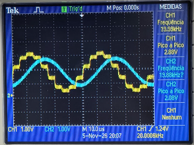

<em>Figura 14 — Ensaio do filtro a 20 kHz. CH1 (amarelo): DAC do STM32. CH2 (azul): saída do filtro.</em>

## Referências

1. [Texas Instruments — TL084 JFET-Input Operational Amplifier](https://www.ti.com/lit/ds/symlink/tl084.pdf)
2. [Texas Instruments — CD4051B CMOS Analog Multiplexer/Demultiplexer](https://www.ti.com/lit/ds/symlink/cd4051b.pdf)
3. [Texas Instruments — TL081 JFET-Input Operational Amplifier](https://www.ti.com/lit/ds/symlink/tl081.pdf)
4. [STMicroelectronics — STM32F439ZI](https://www.st.com/resource/en/datasheet/stm32f439zi.pdf)
5. SEDRA, Adel S.; SMITH, Kenneth C. *Microeletrônica*. 7. ed. São Paulo: Pearson Education do Brasil, 2017.
