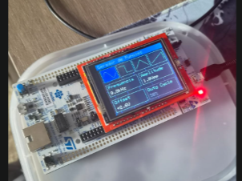
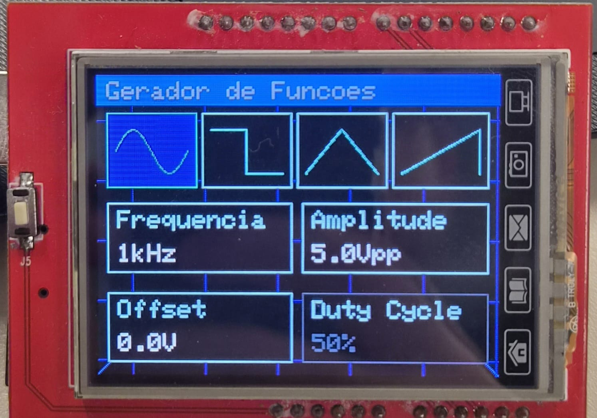
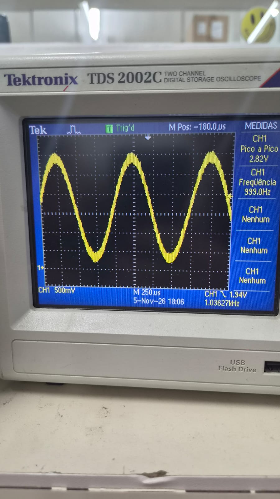
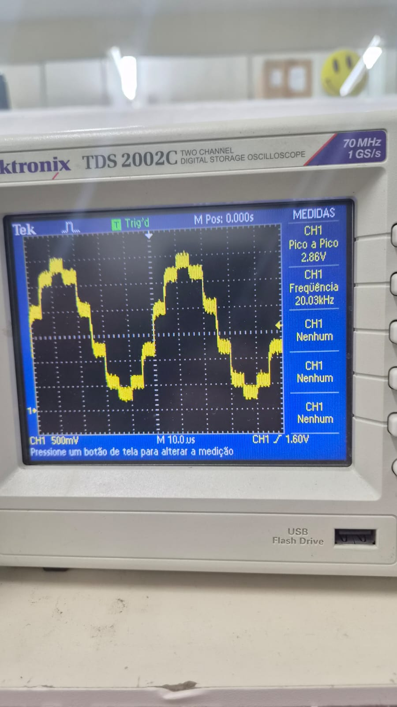
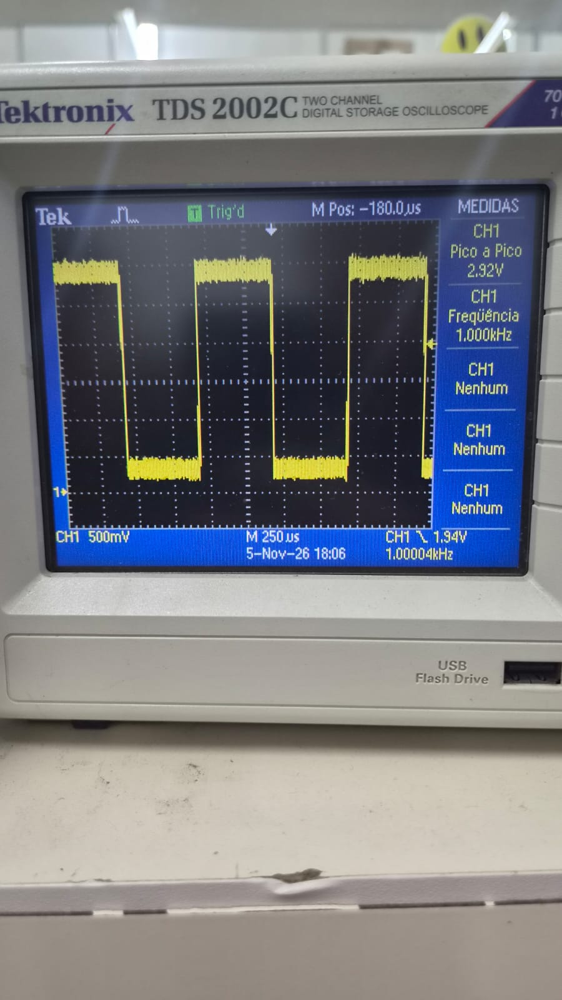

# Software da Etapa 3

Nesta etapa, o protótipo da interface criado no Arduino foi portado para a placa NUCLEO-F439ZI e integrado à geração de sinais do STM32F439ZI [1][8]. O firmware foi desenvolvido em C no STM32CubeIDE 2.2.0, com acesso aos periféricos pelos registradores e definições do CMSIS [2]. O FreeRTOS Kernel foi utilizado para organizar o controle do sinal, a interface gráfica e o diagnóstico serial em tarefas independentes [3].

O display adotado é um shield TFT resistivo MCUFRIEND de 2,4 polegadas, com controlador RM68090 e barramento paralelo de 8 bits [4]. Como não havia um driver pronto para essa combinação de placa, shield e controlador, foi implementado um driver específico para o STM32. A sequência de inicialização, a fonte gráfica e as primitivas de desenho foram baseadas nas referências das bibliotecas MCUFRIEND_kbv e Adafruit GFX [5][6].

## Desenvolvimento

### Projeto STM32

A cópia do [projeto integrado](./function_generator_display_integration/) reúne o código-fonte atual do workspace do grupo, os arquivos do STM32CubeIDE e os presets de compilação Debug e Release. O CMSIS e o FreeRTOS acompanham o projeto. Para recompilar, importe a pasta como projeto existente no STM32CubeIDE ou use CMake, Ninja e o GCC para ARM.

### Validação inicial e organização do firmware

O desenvolvimento começou com um projeto mínimo de acionamento dos LEDs da placa, usado para validar clock, GPIO, compilação, gravação e comunicação com o ST-LINK. Em seguida, o FreeRTOS foi integrado e o escalonador foi testado com a sequência visual LD1–LD2–LD3–LD2–LD1. Após essa validação, as tarefas foram separadas em arquivos próprios e os endereços de registradores inicialmente escritos de forma manual foram substituídos pelos cabeçalhos oficiais do CMSIS.

A arquitetura final utiliza três tarefas:

| Tarefa | Prioridade | Pilha | Responsabilidade |
|:--|:-:|:-:|:--|
| `SignalControl` | 5 | 1536 bytes | Inicialização e controle central do sinal |
| `SerialControl` | 4 | 1536 bytes | Comandos de diagnóstico pela USART3 |
| `Interface` | 1 | 1536 bytes | Display, touch e navegação |

O módulo `signal_control` mantém o estado do gerador, valida os limites e protege as alterações concorrentes com mutex. O driver `waveform_generator` controla o canal 1 do DAC1 e o temporizador TIM6. A interrupção do TIM6 tem prioridade 4 e opera sem chamadas ao FreeRTOS. A interrupção da USART3 tem prioridade 7.

### Display, touch e interface

A Figura 1 mostra a montagem da placa NUCLEO-F439ZI com o display resistivo em funcionamento.

  

<em>Figura 1 — Placa NUCLEO-F439ZI com o display touchscreen.</em>

O driver do display configura o barramento paralelo, inicializa o RM68090 e fornece operações para cores, linhas, retângulos, texto e orientação. O touch resistivo, cuja implementação tomou como referência a Adafruit TouchScreen [7], utiliza o ADC1 nos canais 10 e 13 e compartilha alguns pinos com o LCD. Depois de cada leitura do toque, esses pinos são restaurados para a função de saída do display. O touch é consultado aproximadamente a cada 10 ms, mas a tela é redesenhada somente quando há mudança de estado, evitando atualizações completas desnecessárias.

A tela principal, mostrada na Figura 2, reúne as quatro formas de onda e os controles de frequência, amplitude, offset e duty cycle. A escolha da forma de onda é aplicada imediatamente.

  

<em>Figura 2 — Tela principal do gerador, com a senoide selecionada.</em>

Ao tocar em um parâmetro, o usuário pode alterar o valor com o controle deslizante ou com os botões **+** e **−**. O botão **Salvar** confirma o novo valor e **Cancelar** preserva o valor anterior. O duty cycle só pode ser ajustado quando a onda quadrada está selecionada.

### Geração dos sinais

A saída digital-analógica utiliza o DAC1, canal 1, no pino PA4. A senoide é formada a partir de uma tabela mestra com 250 amostras normalizadas. O firmware seleciona automaticamente 250, 125, 50, 25 ou 10 pontos por período. O teto de 200 mil amostras por segundo foi adotado para a implementação por interrupção, sem DMA.

| Frequência configurada | Pontos utilizados |
|:--|--:|
| 1 Hz | 250 |
| 1 kHz | 125 |
| 5 kHz | 25 |
| 20 kHz | 10 |

A onda quadrada também é produzida pelo DAC1 em PA4. A interrupção do TIM6 alterna os níveis baixo e alto conforme o ciclo de trabalho. A saída permanece em nível baixo a 0% e em nível alto a 100%. Ao selecionar triangular ou dente de serra, o firmware gera uma onda quadrada com ciclo de trabalho fixo em 50%. Os [circuitos de conversão analógica](../hardware/README.md#arquitetura-de-geração-das-formas-de-onda) são responsáveis pela formação das rampas.

Os limites aceitos pelo controle são frequência de 1 Hz a 20 kHz, amplitude indicada de 0,0 a 9,8 Vpp, duty cycle de 0% a 100% e offset de −5,0 V a +5,0 V. Para a amplitude, o firmware considera um ganho externo conservador de 3,5 vezes e limita a excursão bruta em PA4 a aproximadamente 2,8 Vpp. O offset é validado e armazenado pela interface, mas ainda não possui atuação elétrica integrada na saída.

### Diagnóstico e autoteste

A porta virtual do ST-LINK utiliza a USART3 em PD8 e PD9, configurada em 115200 bit/s, oito bits de dados, sem paridade, um stop bit e sem controle de fluxo. O número da porta COM depende do computador. Na versão integrada, a serial oferece apenas os comandos de diagnóstico `status` e `selftest`; ela não altera os parâmetros do gerador.

O autoteste mede internamente o mesmo nó de PA4 pelo ADC2, canal 4. O procedimento captura valores durante uma janela entre 100 e 4000 ms, determina mínimo, máximo e média, calcula a amplitude pico a pico e estima a frequência pelos cruzamentos ascendentes. A comparação utiliza tolerância de 20% do valor esperado mais 30 mV para amplitude e 5% mais 2 Hz para frequência. O resultado é informado como aprovado ou falho pela serial.

Esse teste verifica somente a saída bruta do DAC. Ele não mede o amplificador externo, a aplicação elétrica do offset, distorção harmônica, jitter, ruído ou a qualidade completa da forma de onda na saída final.

## Testes

Os testes distinguiram os protótipos intermediários da versão final integrada. Uma primeira senoide fixa de 1 kHz, com 10 pontos e faixa planejada próxima de 0,5 V a 2,5 V, foi observada no osciloscópio com aproximadamente 2,2 Vpp. Outros projetos isolados avaliaram 1 kHz com 25 e 250 pontos, 500 Hz com 250 pontos e 20 kHz com 20 pontos. Este último resultado pertence ao protótipo fixo; no firmware adaptativo final, 20 kHz utiliza 10 pontos.

Em outra medição da senoide de 1 kHz, o painel de medidas do osciloscópio indicou 999,0 Hz e 2,82 Vpp, como mostra a Figura 3.

  

<em>Figura 3 — Senoide de 1 kHz observada no osciloscópio.</em>

A Figura 4 registra a senoide discretizada de 20 kHz. Os degraus da saída são visíveis e o osciloscópio indica 20,03 kHz e 2,86 Vpp.

  

<em>Figura 4 — Senoide discretizada de 20 kHz observada no osciloscópio.</em>

A Figura 5 mostra a onda quadrada gerada pelo DAC, com leitura de 1,000 kHz e 2,92 Vpp no osciloscópio.

  

<em>Figura 5 — Onda quadrada de 1 kHz gerada pelo DAC.</em>

No autoteste da versão integrada, a interface foi configurada para uma senoide de 1 kHz e 1,0 Vpp. Com o ganho externo de 3,5 adotado pelo firmware, a amplitude esperada em PA4 era de aproximadamente 286 mVpp. A tabela reúne os valores obtidos pelo ADC2 em PA4.

| Medida do autoteste | Valor registrado |
|:--|--:|
| Tensão mínima | 1,444 V |
| Tensão máxima | 1,749 V |
| Tensão média | Aproximadamente 1,595 V |
| Amplitude pico a pico | 305 mVpp |
| Frequência estimada | Aproximadamente 1 kHz |

O firmware classificou o ensaio como aprovado.

| Validação | Resultado | Evidência ou observação |
|:--|:-:|:--|
| Projeto mínimo e gravação | Aprovado | Clock, GPIO, ST-LINK e placa operacionais |
| Escalonador do FreeRTOS | Aprovado | Sequência LD1–LD2–LD3–LD2–LD1 |
| Display RM68090 no STM32 | Aprovado | Cores, linhas, texto e orientação |
| Touch resistivo | Aprovado | Navegação e botões operacionais |
| Salvar e Cancelar | Aprovado | Saída alterada somente após confirmação |
| Protótipo com senoide fixa de 1 kHz | Aprovado | Aproximadamente 2,2 Vpp no osciloscópio |
| Senoide de 1 kHz registrada em foto | Observada em bancada | 999,0 Hz e 2,82 Vpp no osciloscópio |
| Senoide discretizada de 20 kHz | Observada em bancada | 20,03 kHz e 2,86 Vpp no osciloscópio |
| Onda quadrada de 1 kHz pelo DAC | Observada em bancada | 1,000 kHz e 2,92 Vpp no osciloscópio |
| Variação da quantidade de pontos | Protótipo aprovado | Ensaios com 10, 25 e 250 pontos |
| Controle de frequência e amplitude | Aprovado | Alteração durante a execução |
| Integração FreeRTOS, display, touch e DAC | Aprovado | Execução simultânea sem travamento observado |
| USART3 | Aprovado | Diagnóstico em 115200 bit/s |
| Autoteste pelo ADC2 | Aprovado | 305 mVpp e aproximadamente 1 kHz |
| Compilação final | Aprovado | `-Wall -Werror`, sem erros ou avisos |

A compilação registrada para a etapa apresentou 35.148 bytes na seção de código, 8 bytes de dados inicializados e 18.960 bytes de dados não inicializados. Os dados em RAM incluem a reserva de 16 kB para o heap do FreeRTOS. Durante os ensaios da etapa, o grupo reconheceu, gravou e verificou a placa com o STM32CubeProgrammer e preservou os option bytes.

O DAC alimentou o filtro senoidal nos [ensaios de 1 Hz a 20 kHz](../hardware/README.md#testes), e os demais blocos analógicos foram avaliados separadamente. Distorção, ruído e jitter ficaram sem caracterização.

## Referências

1. [STMicroelectronics — STM32F439ZI](https://www.st.com/en/microcontrollers-microprocessors/stm32f439zi.html)
2. [Arm — CMSIS](https://arm-software.github.io/CMSIS_6/latest/General/index.html)
3. [FreeRTOS Kernel — documentação oficial](https://www.freertos.org/Documentation/02-Kernel/01-About-the-FreeRTOS-kernel/01-About-the-FreeRTOS-Kernel)
4. [Raydium — RM68090 LCD Controller](https://www.crystalfontz.com/controllers/uploaded/Raydium_RM68090_v0.4.pdf)
5. [MCUFRIEND_kbv](https://github.com/prenticedavid/MCUFRIEND_kbv)
6. [Adafruit GFX Library](https://github.com/adafruit/Adafruit-GFX-Library)
7. [Adafruit TouchScreen](https://github.com/adafruit/Adafruit_TouchScreen)
8. [STMicroelectronics — Manual UM1974 das placas Nucleo-144](https://www.st.com/resource/en/user_manual/um1974-stm32-nucleo-144-boards-mb1137-stmicroelectronics.pdf)
